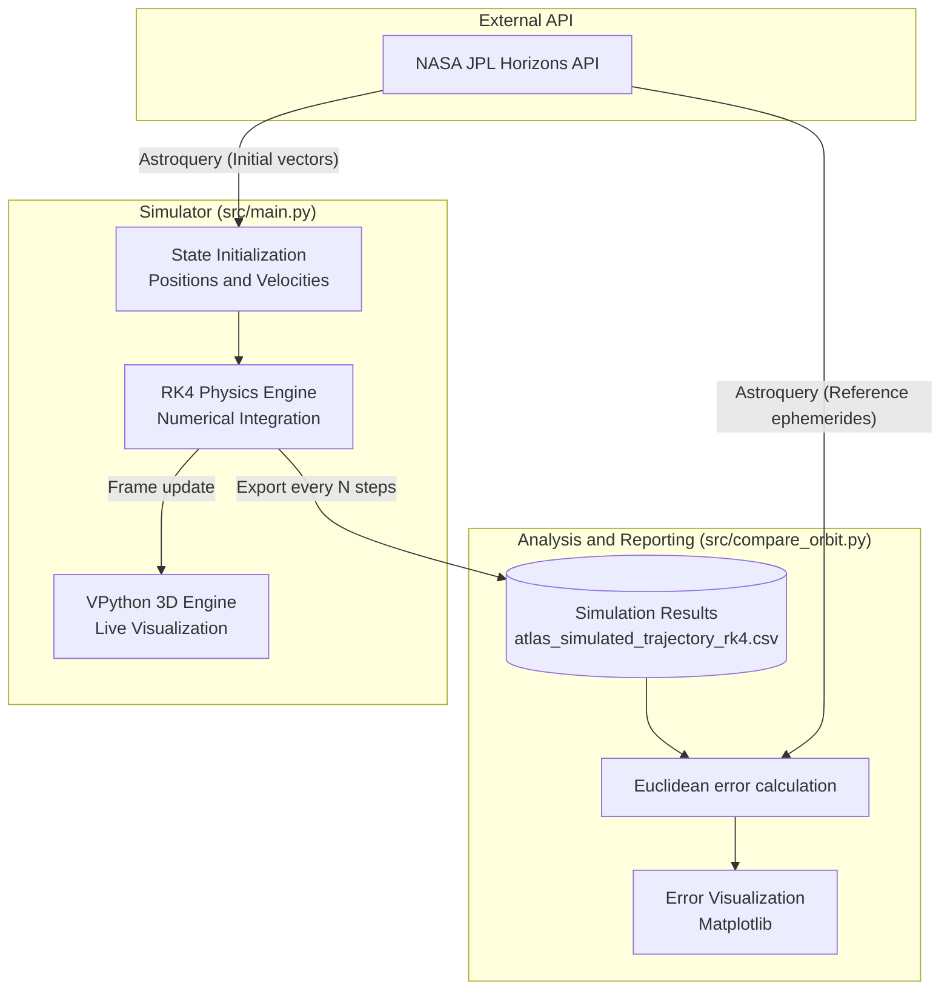

# 🪐 CelestialOrbSim3D

**Precise N-body gravity simulator with a space trajectory analyzer**

## 📖 About the project

**CelestialOrbSim3D** is a custom gravity simulator created in Python, designed for modeling and visualizing the trajectories of objects in the Solar System. The project specifically focuses on analyzing the flight of the **3I/ATLAS** comet. By utilizing the **4th-order Runge-Kutta (RK4)** numerical integration method, the simulator solves the N-body problem, minimizing numerical errors during close flybys (e.g., in the Earth-Moon system). 

The project integrates with the **NASA JPL Horizons** system, fetching real object ephemerides to initialize the starting state and subsequently verify calculation precision.

## 🏗️ System Architecture

The diagram below illustrates the data flow and the modular architecture of the application:



## 🛠️ Technologies Used

The project was built using a modern technology stack within the Python ecosystem, divided into logical layers:

-   **Physics and Computational Engine:**
    *   `Python 3` with strong static typing (`typing`).
    *   **4th-order Runge-Kutta (RK4)** algorithm for precise calculation of accelerations and motion vectors.
-   **Data and API Management:**
    *   `astroquery` (`jplhorizons` module) – direct integration with NASA databases, fetching state vectors (position, velocity) in astronomical units (AU).
    *   `pandas` & `numpy` – high-performance processing of time series, date mapping, and fast vectorized Euclidean distance calculations.
-   **Visualization (Frontend):**
    *   `vpython` – rendering a three-dimensional scene of the Solar System in real-time, tracking object trajectories.
    *   `matplotlib` – generating 2D analytical charts (error accumulation in kilometers) and static 3D comparisons (simulation vs reality).
-   **Quality Assurance (QA):**
    *   `unittest` – built-in unit testing framework, isolating and verifying mathematical and physical logic (force vector directions).

## 📂 Directory Structure

The project maintains a clean separation between source code and tests:

```text
📦 CelestialOrbSim3D
 ┣ 📂 src
 ┃ ┣ 📜 main.py                  # Main simulation loop, 3D engine (vpython) and RK4 implementation
 ┃ ┗ 📜 compare_orbit.py         # Precision verification tool: Compares CSV with JPL data
 ┣ 📂 tests
 ┃ ┣ 📜 test_simulation.py       # Unit tests for physics logic and object searching
 ┃ ┗ 📜 test_compare.py          # Mathematical verification of the trajectory error analysis module
 ┣ 📜 atlas_simulated_trajectory_rk4.csv # (Auto-generated) Simulation run logs
 ┗ 📜 README.md
```

## 🚀 Running the Project

### 1. Install dependencies

```bash
pip install -r requirements.txt
```

### 2. Run 3D Simulation
Run the main script to start the integration and render the visualization. The process will save the comet's positions to a CSV file every 100 simulation steps.

```bash
python src/main.py
```
*Note: The simulation can be interrupted at any time using `Ctrl+C`, which will safely save and close the CSV file.*

### 3. Error Analysis
After generating the `atlas_simulated_trajectory_rk4.csv` file, run the analytical script. It will fetch real data from JPL for the corresponding timeframes and generate error charts:

```bash
python src/compare_orbit.py
```

### 4. Unit Tests
To ensure all mathematical logic works correctly, run the test suite:

```bash
python -m unittest discover -s tests
```
